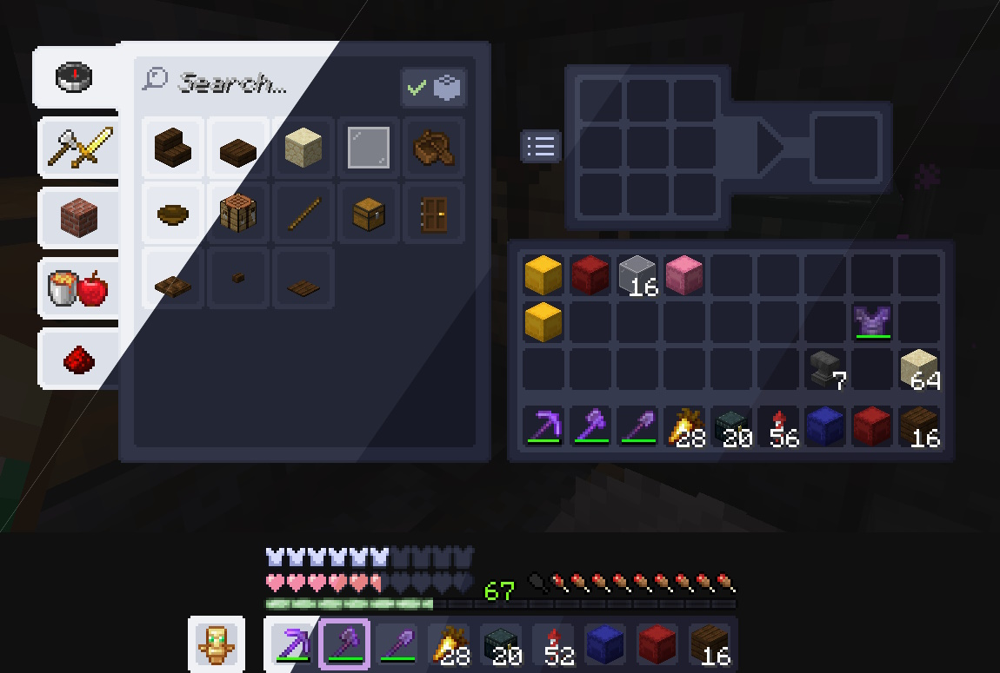
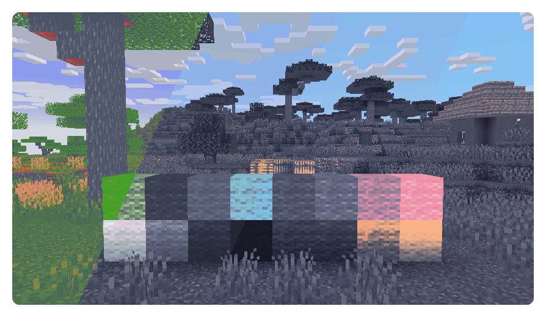

<h3 align="center">
	<br/>
	
	Catppuccin for <a href="https://minecraft.net">Minecraft</a>
	
</h3>

<p align="center">
	<a href="https://github.com/catppuccin/minecraft/stargazers"></a>
	<a href="https://github.com/catppuccin/minecraft/issues"></a>
	<a href="https://github.com/catppuccin/minecraft/contributors"></a>
</p>

<p align="center">
	
	
</p>

## Usage
> [!WARNING]
Only download mods from sources you trust. Mods can execute arbitrary code. In the past, there have been multiple cases of malicious people including malware inside mods. It is very rare, but something everyone should be aware of.

> [!NOTE]
Adding support for new mods in Catppuccin UI is temporarily paused. I plan to add support for more mods in future, so feel free to make mod support requests.


### Resource Pack
1. Go to our Modrinth [versions page](https://modrinth.com/resourcepack/catppuccin-ui/versions) and click on the version with your preferred flavor and the Minecraft version you're playing.
2. Scroll down to the "Files" section and download `Catppuccin {flavor} {accent color}.zip` zip file with your preferred accent color.
3. Move that zip file you downloaded to the `resourcepacks` folder within your `.minecraft` directory (or your Minecraft profile folder, depending on your installation).
4. Launch Minecraft and open the resource packs menu from the options.
5. Select the pack and press done.

## Generating packs from templates
```
usage: create_flavors.py [-h] [-f {Latte,Frappé,Macchiato,Mocha,Frappe}] [-a {Rosewater,Flamingo,Pink,Mauve,Red,Maroon,Peach,Yellow,Green,Teal,Sky,Sapphire,Blue,Lavender}]

Create different flavors of Catppuccin UI resource pack from a template.

options:
  -h, --help            show this help message and exit
  -f, --flavor {Latte,Frappé,Macchiato,Mocha,Frappe}
                        Flavor to create. If not specified, all flavors will be created.
  -a, --accent {Rosewater,Flamingo,Pink,Mauve,Red,Maroon,Peach,Yellow,Green,Teal,Sky,Sapphire,Blue,Lavender}
                        Accent color to create. If not specified, all accent colors will be created.
```
1. From the root directory, run `cd resource-packs/Catppuccin UI`.
2. If you don't have the dependencies installed, install them with `pip install pillow` before runnning the script.
3. Run `python create_flavors.py`. Optionally use the flags `-f` and `-a` to specitify for an single combination.
4. The packs should be generated in the `output` directory inside the Catppuccin UI directory.

The palette used by the resource pack generator is generated from [`minecraft.tera`](minecraft.tera)
with [Whiskers](https://github.com/catppuccin/whiskers). Regenerate it from the repository root:

```sh
whiskers minecraft.tera
```

### Shaders
1. Install [Iris](https://modrinth.com/mod/iris) and [Sodium](https://modrinth.com/mod/sodium).
2. Download a `catppuccin-shaders.zip` zip file from the [releases](https://github.com/catppuccin/minecraft/releases) page.
3. Move it to your shader packs folder within your `.minecraft` directory (or your Minecraft profile folder, depending on your installation).
4. Go to Options -> Video -> Shader Packs.
5. Select the pack.
6. Set the flavor in the shader settings.

## 💝 Thanks to

- [Tnixc](https://github.com/Tnixc)
- [Aurniox](https://github.com/madhavarun)
- [CallMeEcho](https://github.com/CallMeEchoCodes)
- [Locotay](https://github.com/andreasgrafen)
- [JustLetterV](https://github.com/JustLetterV)
- [Gingeh](https://github.com/Gingeh)
- [VoidTwo](https://github.com/VoidTwo)
- [Scarce Koi](https://github.com/scarcekoi)

&nbsp;

<p align="center">
	
</p>

<p align="center">
	Copyright &copy; 2021-present <a href="https://github.com/catppuccin" target="_blank">Catppuccin Org</a>
</p>

<p align="center">
	<a href="https://github.com/catppuccin/catppuccin/blob/main/LICENSE"></a>
</p>
